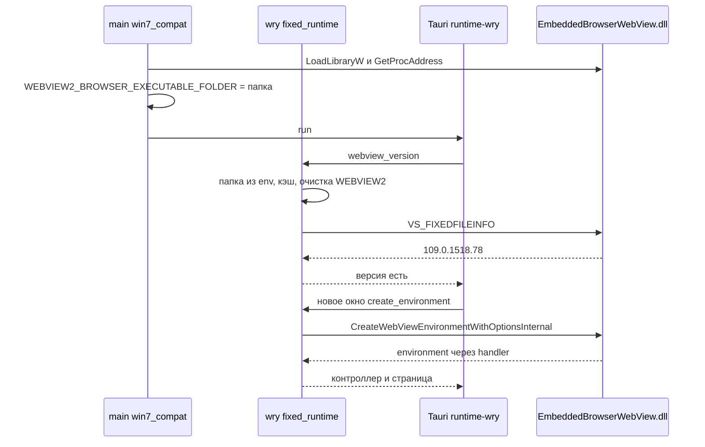

# Windows 7: порт Tauri, как он устроен и почему

Файл для агентов и разработчиков. Здесь всё про сборку под Windows 7: что сделано, как работает порт, почему выбран именно такой путь, что проверено и что нет. Перед любыми изменениями Win7-сборки читать целиком.

Обновлено: 2026-10-17. Итог: приложение установлено и работает на Windows 7 SP1 в VM (WebView2 `109.0.1518.78`). Ветка `win7-wry-patch`, PR в `main`. Что проверено и что нет: разделы 2 и 7. Если что-то устарело, сверьте с `git log`, `gh run list` и исправьте этот файл.

## 1. Цель и контекст

- Нужно: Tauri-версия работает на ПК кафедры физкультуры с Windows 7 SP1. Обычная сборка (Windows 10/11) — `.github/workflows/windows.yml`.
- Рабочая Go-версия для Win7: ветка `legacy-go-version-win7` (Wails 2.7.1, go-webview2 v1.0.10). Работает на Win7-ПК с WebView2 109 в `C:\WebView2`. Удалять её или нет, решает пользователь после проверки на рабочем ПК (раздел 7).
- Файл `tulsu-pe-timetable.exe` в ветке `legacy-go-version-win7` собран Go 1.25.0 и требует `bcryptprimitives.dll` (Windows 8+). Это не Win7-сборка, для тестов не годится.
- На Win7 максимум WebView2 109 (Chromium 109). Фронтенд для win7 собирается с `target: chrome109`.
- Тестовая среда: VirtualBox VM `vboxuser`, Windows 7 SP1 (6.1.7601), английская локализация, из обновлений только KB2534111 и KB976902. Рабочий ПК (русская Win7 SP1) не проверен.
- Репозиторий приватный: `archhaze24/tulsu-pe-timetable`. Пользователь работает на macOS. Правило проекта: не коммитить и не пушить без явной просьбы.

## 2. Итог

- Работает на VM (2026-10-17): установка из NSIS-установщика, запуск, окно и интерфейс, сохранение настроек, факультеты, направления, преподаватели. WebView2 `109.0.1518.78`. По логам и БД сбоев WebView2 и паник нет (раздел 5.4).
- CI: `win7-installer.yml` на ветке `win7-wry-patch`, run `39021161225`, success, около 10 минут. Артефакт `tulsu-pe-timetable-win7` (NSIS-установщик).
- Не проверено: рабочий ПК кафедры (русская Win7 SP1); функции WebView2 вне базового сценария (раздел 7); установка поверх старой версии.
- Известный дефект вне Win7: сохранение преподавателя без направления не проходит (`FOREIGN KEY constraint failed`), пользователю ошибка не показывается. Исправлен: направление без значения хранится как `NULL` (миграция `teachers_direction_nullable`).

## 3. Как устроен порт

Порт не меняет интерфейс и бизнес-логику. Он меняет одно: как Tauri получает WebView2 Runtime на Windows 7. Остальное — штатный Tauri 2, `wry` 0.57.0 и наш фронтенд.

### 3.1 Проблема

- Tauri на Windows создаёт WebView2 через `wry`. `wry` вызывает нативный loader WebView2: `CreateCoreWebView2EnvironmentWithOptions` и `GetAvailableCoreWebView2BrowserVersionString`.
- Loader вшит в exe статически (`webview2-com-sys` 0.39.1 линкует `WebView2LoaderStatic.lib`). На Win7 VM он отвечает `0x80070032` для любой папки runtime. Причина не найдена (раздел 6, п. 12), настройками этого не обойти.
- Go-версия работает на Win7-ПК, потому что не использует нативный loader. Она загружает `EBWebView\x64\EmbeddedBrowserWebView.dll` и вызывает у неё внутреннюю функцию `CreateWebViewEnvironmentWithOptionsInternal` (go-webview2 v1.0.10, `webviewloader/env_create.go`). Мы повторили этот путь: `scripts/win7/test-env.c` v3 на VM создаёт environment и controller и получает версию.

### 3.2 Сборка

- `pnpm build:win7` → `scripts/build-win7.mjs`. Скрипт проверяет `src-tauri/WebView2/msedgewebview2.exe` и запускает `tauri build --config src-tauri/tauri.win7.conf.json` с Rust 1.99.1 (stable), `RUSTC_BOOTSTRAP=1`, `CARGO_UNSTABLE_BUILD_STD=std` и целью `x86_64-win7-windows-msvc`. Nightly 2026-10-15 std для этой цели не собирает.
- `tauri.win7.conf.json`: только NSIS-установщик. Папка runtime (`WebView2`) кладётся рядом с exe как ресурс (`$INSTDIR\WebView2`). `webviewInstallMode: skip`, потому что при `fixedRuntime` Tauri сам перезаписывает `WEBVIEW2_BROWSER_EXECUTABLE_FOLDER`. `staticVCRuntime: false`.
- `build.rs` (только при `target_vendor = "win7"`): `advapi32`, `combase` и `api-ms-win-core-winrt-error` подключаются через delay-load, а хуки в `win7_compat.rs` подменяют функции, которых нет на Win7. Так exe запускается без отсутствующих на Win7 импортов (раздел 4.6).
- `[patch.crates-io] wry = { path = "vendor/wry" }` в `src-tauri/Cargo.toml`: вместо `wry` из crates.io собирается патченная копия из `src-tauri/vendor/wry`.
- Патч активен только при `cfg(target_vendor = "win7")`. Сборки для Windows 10/11 и macOS используют upstream-логику.

### 3.3 Запуск на Windows 7

Установщик ставит приложение в `%LOCALAPPDATA%\Расписание ТулГУ по физкультуре\` (путь из лога VM) и кладёт рядом папку `WebView2\`. Дальше:

1. `main()` вызывает `win7_compat::prepare_webview2_runtime()`:
   - ставит перехватчик паники, паника пишется в `webview2.log`;
   - пишет `exe_dir` в лог;
   - если `WEBVIEW2_BROWSER_EXECUTABLE_FOLDER` уже задана, выходит;
   - перебирает кандидатов `<папка exe>\WebView2`, затем `C:\WebView2`. Для каждого проверяет файл `EBWebView\x64\EmbeddedBrowserWebView.dll`, загружает его (`LoadLibraryW`) и ищет точку входа `CreateWebViewEnvironmentWithOptionsInternal` (`GetProcAddress`);
   - первая подходящая папка становится значением `WEBVIEW2_BROWSER_EXECUTABLE_FOLDER`. Каждый шаг записывается в `webview2.log`.
2. `run()` запускает Tauri. `tauri-runtime-wry` 2.12.2 проверяет `wry::webview_version()` (`src/lib.rs:2783`). Если это ошибка, показывается диалог «WebView2 Runtime не найден» (`src/lib.rs:4678`).
3. `wry::webview_version()` попадает в патч (`fixed_runtime::get()`). При первом вызове патч читает папку из переменной, загружает DLL, сохраняет точку входа в `OnceLock`, очищает переменные `WEBVIEW2_*` и возвращает версию из `VS_FIXEDFILEINFO` DLL: `109.0.1518.78`. Диалога нет.
4. Открытие окна: `new_in_hwnd` вызывает `create_environment`, если окружение не передано извне. Если runtime активен, в options ставится `TargetCompatibleBrowserVersion` = `86.0.616.0`, затем вызывается `CreateWebViewEnvironmentWithOptionsInternal(1, 1, userDataFolder, options, handler)`. Результат приходит асинхронно через handler, `wry` ждёт его, прокачивая сообщения окна.
5. `create_controller`, `init_webview`, обработчики событий, IPC и кастомный протокол работают как в upstream `wry`. Через них загружается фронтенд, и приложение работает штатно.
6. Если ни одна папка не подошла, переменная не задаётся, патч не активен, и `wry` идёт upstream-путём через нативный loader. На Win7 это даёт диалог «WebView2 Runtime не найден». Причина видна в `webview2.log`.



Ожидаемый `webview2.log` при успешном старте (строки из лога VM, пути сокращены):

```
exe_dir: Some("C:\\Users\\<user>\\AppData\\Local\\Расписание ТулГУ по физкультуре")
C:\Users\<user>\AppData\Local\Расписание ТулГУ по физкультуре\WebView2: EmbeddedBrowserWebView.dll загружена, точка входа найдена
выбрана папка: C:\Users\<user>\AppData\Local\Расписание ТулГУ по физкультуре\WebView2
```

Диагностика по симптомам:

| Симптом | Что значит | Где смотреть |
|---|---|---|
| Диалог «WebView2 Runtime не найден» | Патч не получил папку или не прочитал версию | `webview2.log`: есть ли строка `выбрана папка`, почему отвергнут кандидат (`LoadLibraryW` или `GetProcAddress`) |
| Приложение закрылось без окна | Паника или ошибка создания окна | `webview2.log`: строка `panic: …` |
| В логе `0x80070032` | Работает нативный путь, патч не активен | Есть ли папка `WebView2` рядом с exe, есть ли строка `выбрана папка` |
| `FOREIGN KEY constraint failed` в `logs\app-*.log` | Дефект валидации, не Win7 | Исправлено (миграция направления) |

### 3.4 Почему именно так

Для каждого решения: почему выбрано и что отбросили.

- **Внутренняя функция DLL вместо нативного loader.** Нативный путь на Win7 даёт `0x80070032`. Внутренний путь проверен: Go-версия работает на Win7-ПК этим путём, `test-env` v3 и приложение работают на VM. Отброшено: подменять loader через DLL (он статический, раздел 6, п. 17); ждать исправлений в upstream (на это не рассчитываем).
- **Патч `wry`, а не свой слой поверх Tauri.** Environment создаёт сам `wry` (`create_environment`). Снаружи вызвать его нельзя, а Tauri не даёт нужного hook. Отброшено: форк Tauri целиком (слишком большой); патч `webview2-com-sys` (сгенерированные биндинги, больше правок); форк `wry` на GitHub (отдельный репозиторий и сеть при сборке).
- **Vendored копия через `[patch.crates-io]`.** Собирается без сети, правки видны в PR и ревью, весь патч ограничен `cfg(target_vendor = "win7")`. Исходники копии около 1 МБ.
- **Путь через `WEBVIEW2_BROWSER_EXECUTABLE_FOLDER`.** Это штатная переменная WebView2. `prepare` её выставляет, `wry` читает, новый API между крейтами не нужен. Отброшено: передавать путь через новые функции, что потребовало бы менять сигнатуры `wry` и `tauri-runtime-wry`.
- **Очистка `WEBVIEW2_*` перед вызовом, папка запоминается в `OnceLock`.** Go-версия очищает переменные перед вызовом (`preventEnvAndRegistryOverrides`), и мы повторяем это: `WEBVIEW2_PIPE_FOR_SCRIPT_DEBUGGER`, `WEBVIEW2_ADDITIONAL_BROWSER_ARGUMENTS`, `WEBVIEW2_RELEASE_CHANNEL_PREFERENCE` (`0`), `WEBVIEW2_BROWSER_EXECUTABLE_FOLDER`, `WEBVIEW2_USER_DATA_FOLDER`. Что случится без очистки, не проверяли. Папку запоминаем, потому что после очистки переменной уже нет, а версия и повторные вызовы её ещё используют.
- **Проверка папки через `LoadLibraryW` и `GetProcAddress`.** Файлы в папке не гарантируют рабочую DLL. Проверка берёт ту же точку входа, которую потом вызовет патч. Ошибка `GetLastError` попадает в лог. Отброшено: проверять только наличие файлов.
- **Порядок кандидатов: `<exe>\WebView2`, затем `C:\WebView2`.** Первая папка — установка через инсталлятор. Вторая — место, где Go-версия держит runtime, так что тот же runtime подойдёт и без установки.
- **`webviewInstallMode: skip`.** При `fixedRuntime` Tauri перезаписывает `WEBVIEW2_BROWSER_EXECUTABLE_FOLDER`, и наш выбор теряется (раздел 6, п. 10).
- **`TargetCompatibleBrowserVersion` = `86.0.616.0`.** По умолчанию `webview2-com` ставит `145.0.3800.47` (версия SDK), которая новее runtime 109. Go-версия использует `86.0.616.0` (`kMinimumCompatibleVersion`), и с ним приложение работает на VM. Гипотеза «145 даёт `ERROR_NOT_SUPPORTED`» отдельно не проверялась (раздел 6, п. 22). Для порта её подтверждать не нужно.
- **Версия из `VS_FIXEDFILEINFO` файла DLL.** Upstream `platform_webview_version` вызывает `GetAvailable(NULL)`, который нашу папку не видит. Тогда `webview_runtime_installed` стало бы `false`, и появился бы диалог. Версия из DLL совпадает с `ProductVersion`, который использует Go-версия: `109.0.1518.78`, сверено с локальной DLL.
- **Перехват паники в `webview2.log`.** Release-сборка с `windows_subsystem = "windows"` не имеет консоли. Без лога паника закрывает приложение молча.
- **Патч только под `cfg(target_vendor = "win7")`.** Поведение Windows 10/11 и macOS не меняется, ветки win7 не компилируются. Общее для всех платформ только настройки lint'ов в `vendor/wry/Cargo.toml` (раздел 6, п. 24).
- **Lint'ы в манифесте, а не в исходниках.** Path-зависимость показывает свои предупреждения. В macOS их было 17, все в upstream-коде. Глушим в `Cargo.toml` вендорной копии, исходники не трогаем.
- **Rust stable 1.99.1 + `RUSTC_BOOTSTRAP` + `build-std`.** Nightly 2026-10-15 не собирает std для `x86_64-win7-windows-msvc` (раздел 6, п. 1).
- **delay-load и `crt-static`.** Exe не должен импортировать API, которых нет на Win7 (раздел 4.6). Обновления ОС для этого не нужны: KB2670838 их не даёт (раздел 5.2).

### 3.5 Что меняется при обновлении wry или Tauri

- `wry` закреплён на 0.57.0 (`Cargo.lock`), `tauri-runtime-wry` на 2.12.2. Патч накладывается именно на эти версии.
- При обновлении Tauri: проверить версию `wry`, перенести правки по `src-tauri/vendor/README.md`, собрать для `x86_64-win7-windows-msvc` через копию (раздел 8), прогнать CI и проверить на VM.

## 4. Что сделано (по файлам)

### 4.1 Фронтенд (`frontend/`)

- `vite.config.ts`: режим `vite build --mode win7` даёт `build.target: 'chrome109'` и плагин `chrome109Css`.
  - Почему: Tailwind 4 пишет `oklch()` и `color-mix(in oklab, var(--color-…) P%, transparent)`. WebView2 109 их не понимает.
  - Как: lightningcss с `targets: { chrome: 109 << 16 }` в два прохода. Если после сборки остались `oklch(` или `color-mix(... var(`, сборка падает.
  - Плейсхолдер `::placeholder` заменяется на непрозрачный вариант с `opacity:.5`.
- `package.json`: скрипт `build:win7` = `vite build --mode win7`, devDependency `lightningcss ^1.33.0`.
- Плагин держим внутри `vite.config.ts`: отдельный `.ts`-файл без расширения даёт warning Vite, с расширением нужны `allowImportingTsExtensions` и `noEmit`, что даёт warning svelte-check.

### 4.2 Конфиги и Rust (`src-tauri/`)

- `tauri.win7.conf.json`:
  - `build.beforeBuildCommand`: `pnpm --dir frontend build:win7`;
  - `build.windows.staticVCRuntime: false`;
  - `bundle.targets`: `["nsis"]`;
  - `bundle.resources`: `{ "WebView2": "WebView2" }`. Папка runtime попадает в установку как `$INSTDIR\WebView2`;
  - `bundle.windows.webviewInstallMode`: `{ "type": "skip" }`. Почему: при `fixedRuntime` Tauri (2.12.4, `app.rs`) всегда перезаписывает `WEBVIEW2_BROWSER_EXECUTABLE_FOLDER` значением `<exe>\./WebView2/`.
- `.cargo/config.toml`: `[target.'cfg(all(windows, target_env = "msvc"))'] rustflags = ["-C", "target-feature=+crt-static"]`. Почему: `cc` (sqlite) собирает C с `/MD` без него.
- `tauri.conf.json`: `bundle.icon` += `icons/icon.ico`.
- `build.rs`: при `CARGO_CFG_TARGET_VENDOR == "win7"` добавляет `delayimp.lib` и `/DELAYLOAD:` для `advapi32.dll`, `combase.dll`, `api-ms-win-core-winrt-error-l1-1-0.dll` (`cargo:rustc-link-arg-bins`).
- `src/main.rs`: `#[cfg(all(windows, target_vendor = "win7"))] mod win7_compat;` и вызов `win7_compat::prepare_webview2_runtime()` перед `run()`.
- `src/win7_compat.rs`:
  - хуки delay-load: `__pfnDliNotifyHook2` (combase → ole32, winrt-error → kernel32), `__pfnDliFailureHook2` (`EventSetInformation` → 0, `RoOriginateErrorW` → FALSE). Это работает, оставить. Подмена грузится по полному пути в `System32` (`GetSystemDirectoryW` + `LoadLibraryW`), а не по короткому имени: поиск по имени смотрит и папку exe (S-04);
  - `prepare_webview2_runtime()`: выбирает папку через `LoadLibraryW` + `GetProcAddress` (точка входа `CreateWebViewEnvironmentWithOptionsInternal`) и ставит `WEBVIEW2_BROWSER_EXECUTABLE_FOLDER`. `install_panic_log()` пишет панику в `webview2.log`: в release-сборке (`windows_subsystem = "windows"`) её не видно;
  - хуки в бинарнике, а не в rlib: объекты бинарника линкуются всегда;
  - edition 2024: `#[unsafe(no_mangle)]`, `unsafe extern "system" {}`.
- `src-tauri/vendor/wry/` — патч `wry` 0.57.0 для Windows 7 (`[patch.crates-io]` в `src-tauri/Cargo.toml`). Описание: `src-tauri/vendor/README.md`.
  - `src/webview2/fixed_runtime.rs` (новый): `CreateWebViewEnvironmentWithOptionsInternal(1, 1, userData, options, handler)` из `EBWebView\x64\EmbeddedBrowserWebView.dll`. Папка берётся из `WEBVIEW2_BROWSER_EXECUTABLE_FOLDER` один раз, перед вызовом очищаются `WEBVIEW2_*` (как в `test-env.c`). Версия берётся из `VS_FIXEDFILEINFO` (для локальной DLL: `109.0.1518.78`).
  - `src/webview2/mod.rs`: `create_environment` ставит `TargetCompatibleBrowserVersion` = `86.0.616.0` и вызывает `create_environment_with_options`; `platform_webview_version` берёт версию из `fixed_runtime`. Без папки всё как upstream.
  - `Cargo.toml`: фича `Win32_Storage_FileSystem`; `[lints.rust]` глушит `deprecated` и `unused_unsafe`, в `check-cfg` добавлен `macos_12_unavailable` (раздел 6, п. 24).
  - Почему патч, а не настройка: loader вшит статически (раздел 6, п. 17).
- `.gitignore`: `src-tauri/WebView2` (444 МБ, `msedge.dll` 229 МБ > лимита GitHub), `WebView2-*.zip`.

### 4.3 Скрипты (`scripts/`)

- `build-win7.mjs`: проверяет `src-tauri/WebView2/msedgewebview2.exe` и запускает `pnpm tauri build --config src-tauri/tauri.win7.conf.json` с `RUSTUP_TOOLCHAIN=${WIN7_TOOLCHAIN ?? 'stable'}`, `RUSTC_BOOTSTRAP=1`, `CARGO_UNSTABLE_BUILD_STD=std`, `CARGO_BUILD_TARGET=x86_64-win7-windows-msvc`. Дополнительные аргументы проверяются: допускаются только буквы, цифры и `_=.,/-`, потому что на Windows они идут через shell (S-05).
- `win7-imports.py`: разбор таблиц импорта PE (обычная и отложенная), запускать как `python3 -B`. Код возврата 1, если в обычной таблице есть подозрительные импорты. В CI запускается шагом «Проверить импорты exe».
- `scripts/win7/` (тесты для Windows 7 без сборки Tauri, в репозитории):
  - `test-env.c` (v3): создание environment через `EmbeddedBrowserWebView.dll`, повторяет pure-Go loader: options-объект, пустые `WEBVIEW2_*`, лог после каждого шага, vectored exception handler (код, адрес, смещение в модуле). Прошёл на VM. Базовый тест pure-пути, сборка и запуск в разделе 8;
  - `check-runtime.ps1`: какие функции из импортов runtime-DLL отсутствуют в системе;
  - `test-loader2.ps1`: нативный `GetAvailable` для старого загрузчика и наличие API-наборов. Ожидает `C:\test\WebView2Loader.dll` (старый загрузчик из `go-webview2` v1.0.10, файл `webviewloader/x64/WebView2Loader.dll`);
  - `test-shim.ps1`: тест shim `api-ms-win-appmodel-runtime-l1-1-2.dll` (отрицательный результат).

### 4.4 CI (`.github/workflows/`)

- `win7-installer.yml` (`main`): `workflow_dispatch`, `windows-latest`, Rust `1.99.1` с `rust-src`, Node 24, версия pnpm из `packageManager` в корневом `package.json`. После сборки шаг «Проверить импорты exe» (`scripts/win7-imports.py`) падает при подозрительных импортах в обычной таблице (CI-04). Шаг «Скачать WebView2» из релиза `webview2-109`. Артефакт `tulsu-pe-timetable-win7`, хранится 7 дней. Запускается на любой ветке через `--ref`, в том числе на `win7-wry-patch`.
- `windows.yml` (`main`): `check` на PR, push в `main` и теги (`pnpm check`, прошёл на PR #77 и #78). `build` и `release` на теги `v*` ещё не запускались. Для PR из `win7-wry-patch` в `main` `check` запускается на `windows-latest` и проверяет сборку для Windows 10/11 с патченным `wry`: локально полная Windows-сборка невозможна (раздел 6, п. 25).

### 4.5 Релиз WebView2

- Релиз `webview2-109`, ассет `WebView2-109.zip` (207 755 364 байт), `msedgewebview2.exe` в корне архива. Версия 109.0.1518.78.
- Внутри: `EBWebView/x64/EmbeddedBrowserWebView.dll` (4.8 МБ, его проверяет загрузчик), `msedge.dll` (229 МБ), `msedgewebview2.exe`.
- Локальная копия для анализа: `src-tauri/WebView2/` (в git не попадает).

### 4.6 Импорты exe (решено)

| Импорт (до фиксов) | Что сделано |
|---|---|
| `advapi32.dll!EventSetInformation` (ETW, Windows 8+), из статического `WebView2LoaderStatic.lib` | `advapi32.dll` в `/DELAYLOAD`, заглушка возвращает 0 |
| `combase.dll`: `CoCreateFreeThreadedMarshaler`, `CoTaskMemFree`, `CoTaskMemAlloc` | `combase.dll` в `/DELAYLOAD`, подмена на `ole32.dll` |
| `api-ms-win-core-winrt-error-l1-1-0.dll!RoOriginateErrorW` | DLL в `/DELAYLOAD`, подмена на `kernel32.dll`, заглушка возвращает FALSE |
| `api-ms-win-crt-*` (UCRT, нужен KB2999226) | `staticVCRuntime: false` и `+crt-static` |

В `kernel32` после этого +22 функции из статического CRT (`CompareStringW`, `GetACP`, `IsProcessorFeaturePresent`, `VirtualQuery` и др.). Все из эпохи Windows 2000/XP/Vista (по знанию API, страницы Microsoft не открывал).

Итог `scripts/win7-imports.py` на `38975552911`: в обычной таблице 11 DLL, подозрительных импортов нет. В отложенной: `advapi32`, `combase`, `api-ms-win-core-winrt-error-l1-1-0`. Порт добавляет `LoadLibraryW`, `GetProcAddress`, `GetSystemDirectoryW` (`kernel32`); `LoadLibraryA` убран, подмены грузятся по полному пути (S-04) и `GetFileVersionInfo*`, `VerQueryValueW` (`version.dll`, не `api-ms-win-core-version`, которого на VM нет). Запуск на VM подтверждает, что загрузчик это принимает.

## 5. Проверки: что подтверждено

### 5.1 Сборка и CI

- CI `38970975453`: импорты не проходили загрузчик. `38975552911` (`main@f47b4a9`): успех, импорты проходят. Установщик содержит `WebView2/msedgewebview2.exe` и `WebView2/EBWebView/x64/EmbeddedBrowserWebView.dll`.
- CI `39021161225` (`win7-wry-patch`, коммит `7fea21e`): success, около 10 минут. Артефакт `tulsu-pe-timetable-win7`.
- Экспорты `EmbeddedBrowserWebView.dll`: `CreateWebViewEnvironmentWithOptionsInternal`, `DllCanUnloadNow`. Импорты runtime (`objdump -p`): `msedgewebview2.exe` → `KERNEL32`, `msedge_elf.dll`; `msedge.dll` → `KERNEL32`, `OLEAUT32`, `WINMM`, `msedge_elf.dll`; `EmbeddedBrowserWebView.dll` → `KERNEL32`, `OLEAUT32`; `msedge_elf.dll` → `KERNEL32`. Прямых `api-ms-win-*` и UCRT нет.
- Импорты `WebView2Loader.dll` (`webview2-com-sys` 0.39.1): eager-импорт только `KERNEL32`. Остальное грузится динамически: `kernelbase.dll`, `version.dll`, `api-ms-win-core-version-l1-1-0`, `api-ms-win-appmodel-runtime-l1-1-2`, `api-ms-win-core-synch-l1-2-0`, `ole32`, `shell32`.

### 5.2 Нативный путь на VM: почему он не работает

- `webview2 (2).log`: `<exe>\WebView2` → `hr=0x80070032`, `C:\WebView2` → `hr=0x80070032`, итоговая проверка Tauri (`env=None`) → `hr=0x80070002`.
- `result.txt` (старый загрузчик, PowerShell): `C:\WebView2` → `0x80070032`, `NULL` → `0x80070002`.
- `result-shim.txt`: shim `api-ms-win-appmodel-runtime-l1-1-2.dll` не помог, гипотеза AppModel отвергнута.
- `result2-vm.txt`: отсутствуют API-наборы `api-ms-win-core-version-l1-1-0`, `api-ms-win-core-synch-l1-2-0`, `api-ms-win-appmodel-runtime-l1-1-2` (ошибка 126), а также `kernelbase.dll!GetCurrentApplicationUserModelId` и `GetCurrentPackageFullName`. `version.dll!GetFileVersionInfoExW` есть.
- `check-vm.txt`: runtime-DLL загружается, отсутствуют 0 из 207 функций `kernel32` и 0 из 13 `oleaut32`.
- Сравнение загрузчиков: версии файлов 1.0.3800.47 (`webview2-com-sys` 0.39.1) и 1.0.992.28 (`go-webview2` 1.0.10). Строки одинаковые, кроме новых в 1.0.3800 (ETW, `ChannelSearchKind`, `ReleaseChannels`).
- Go-версия: `pkg/edge/chromium.go:136` для фиксированного пути вызывает Go-реализацию версии, а не нативный `GetAvailable`.
- `webview2-com` 0.39.1 (`src/options.rs`): `CoreWebView2EnvironmentOptions::default()` берёт `TargetCompatibleBrowserVersion` из `CORE_WEBVIEW_TARGET_PRODUCT_VERSION` = `145.0.3800.47` (`webview2-com-sys` `bindings.rs:1013`). Go-версия подставляет `86.0.616.0`.
- Обновления Windows 7 (проверено по содержимому `.msu`):
  - KB2670838 x64 (Platform Update) содержит `api-ms-win-downlevel-*` и DirectX. `api-ms-win-core-*` и `kernelbase.dll` в нём нет, поэтому он не закрывает недостающие API-наборы. Не ставить как фикс.
  - KB2533623 и KB2999226: Win7-вариантов в каталоге Microsoft Update не нашёл.
  - SSU KB4490628 и SHA-2 KB4474419 v3 скачаны, но не проверены на VM. Ставить, только если понадобятся.

### 5.3 Pure-путь: тесты `test-env`

- v1 (APPCRASH, `crash.txt`): `options = NULL` и переменная с папкой. Падение в `get_TargetCompatibleBrowserVersion` (vtable №7). Вывод: options обязателен.
- v2 (APPCRASH, `crash2.txt`): environment создан, `QueryInterface` вызван уже после возврата из callback. Падение на `get_BrowserVersionString`. Вероятная причина: объект из callback освобождён (COM-время жизни). Отдельно не выделено, согласуется с данными.
- v3 (`env-result.txt`, `result.txt` идентичны, Win7 VM): все шаги с кодом `0x00000000`: `CreateWebViewEnvironmentWithOptionsInternal`, `environment completion`, `CreateCoreWebView2Controller`, `controller completion`, `get_BrowserVersionString`. Версия `browser version: 109.0.1518.78`. `Crashpad/reports` пуст.

### 5.4 Финальный прогон приложения на VM (2026-10-17)

- Установка из артефакта и запуск: успех. Окно открывается, интерфейс работает.
- `webview2.log` последнего старта: выбрана папка `…\WebView2`, DLL загружена, точка входа найдена, паник нет.
- `logs/app-2026-10-17.log`: 4 запуска, сохранение настроек, создание факультета, направления и преподавателя. Ошибки: две `FOREIGN KEY constraint failed` при создании преподавателя (дефект исправлен).
- БД (проверка на копии вместе с `-wal` и `-shm`): `integrity_check` = `ok`, `foreign_key_check` пустой, режим WAL. Данные: 1 направление, 1 факультет, 1 преподаватель, семестров и пар нет.

### 5.5 Локально (macOS)

- `pnpm check`: проходит, без предупреждений.
- `wry` с патчем: `cargo check` для `x86_64-win7-windows-msvc` (с `build-std`, `target_vendor = "win7"` активен) и для `x86_64-pc-windows-msvc`. Проверено на отдельной копии (раздел 8).
- `win7_compat.rs`: `rustc --emit=metadata` для `x86_64-pc-windows-msvc`, без ошибок и предупреждений.
- Полная Windows-сборка локально невозможна (`libsqlite3-sys`, раздел 6, п. 25). Проверит `windows.yml` на PR.
- Версия по `VS_FIXEDFILEINFO` локальной `src-tauri/WebView2/EBWebView/x64/EmbeddedBrowserWebView.dll`: `109.0.1518.78`.
- Поиск IID в локальной DLL: найдены `ICoreWebView2_2`, `_4`, `_10`, `_13`, `ICoreWebView2Environment9`, `ICoreWebView2Environment10`. Не найдены `ICoreWebView2_19`, `_22`, `ICoreWebView2Settings2..9`, `ICoreWebView2Controller2`, `ICoreWebView2Controller4`, `ICoreWebView2Profile7`. Отсутствие IID не доказывает отсутствие интерфейса. По коду `wry` эти интерфейсы нужны опциональным функциям (`set_memory_usage_level`, `load_extensions`, `clear_all_browsing_data`, цвет фона, drag-and-drop) или проверяются через `if let Ok` (`Settings*`, `_22`). Раздел 6, п. 27.

## 6. Грабли (не повторять)

1. Nightly от 2026-10-15 не собирает std для `x86_64-win7-windows-msvc`. Работает stable 1.99.1 с `RUSTC_BOOTSTRAP=1`.
2. Tauri CLI отвергает `--target x86_64-win7-windows-msvc`. Использовать `CARGO_BUILD_TARGET`.
3. `build.windows.staticVCRuntime` по умолчанию `true` → `ucrt.lib` → `api-ms-win-crt-*`. Для win7 — `false`.
4. `cc` без `crt-static` собирает C с `/MD`. Нужен `+crt-static`.
5. Ошибка загрузчика Windows = первый отсутствующий импорт. Полный список — скриптом.
6. Git: runtime не коммитить. `msedge.dll` 229 МБ > лимита GitHub 100 МБ. Только релиз.
7. Vite: `.ts`-плагин держим в `vite.config.ts`.
8. Edition 2024: `#[unsafe(no_mangle)]`, `unsafe extern "system" {}`.
9. Хуки delay-load — в бинарнике, не в rlib.
10. При `fixedRuntime` Tauri перезаписывает `WEBVIEW2_BROWSER_EXECUTABLE_FOLDER`. Свой выбор папки работает только при `skip`.
11. `tauri build --no-bundle` на macOS с `bundle.resources` копирует `WebView2` (444 МБ) в `src-tauri/target/debug/`. Удалить после проверки.
12. `0x80070032` у нативного `GetAvailable` на Win7 VM: причина не найдена. Не путь, не версия загрузчика, не AppModel (shim не помог). Порт её обходит, для порта она не нужна. Не путать с `0x80070002` (runtime не найден, нормально для `NULL`).
13. Go-exe из `legacy-go-version-win7` — Go 1.25.0, требует `bcryptprimitives.dll`. Не тестовая сборка для Win7 и не baseline. Baseline нужен Go 1.20 (последний с Win7).
14. `wmic qfe get HotFixID` показывает только QFE-обновления. Platform Update (KB2670838) даёт `api-ms-win-downlevel-*` и DirectX, а не `api-ms-win-core-*`. Не полагаться на него как на фикс.
15. Git: после squash-мерджа PR нельзя продолжать ту же ветку с её старой историей: появляются add/add конфликты. Новую работу делать от `main`.
16. `gh` работает без песочницы в этом треде.
17. `webview2-com-sys` на msvc линкует loader статически. Подменить `CreateCoreWebView2EnvironmentWithOptions` из отдельной DLL нельзя. Обход только через `EmbeddedBrowserWebView.dll` (патч `wry`).
18. Upstream-проверка Tauri `wry::webview_version()` идёт через `GetAvailable(NULL)` и не видит папку из `WEBVIEW2_BROWSER_EXECUTABLE_FOLDER`. В патче при заданной папке версия берётся из DLL (`fixed_runtime::version`), `GetAvailable` не вызывается.
19. Shim-DLL собирать mingw-w64 с `-nostdlib` и входом `DllMain`. Иначе появляются `api-ms-win-crt-*` импорты, которых нет без KB2999226. Для exe аналогично: `-nostdlib -nostartfiles -Wl,-e,mainCRTStartup`.
20. Options-объект для `CreateWebViewEnvironmentWithOptionsInternal` обязателен. `NULL` даёт access violation в `EmbeddedBrowserWebView.dll` (APPCRASH на VM, v1).
21. Pure-путь требует пустые `WEBVIEW2_*` при вызове. Папка передаётся через `WEBVIEW2_BROWSER_EXECUTABLE_FOLDER`: патч читает её один раз и очищает переменные перед вызовом (решено в патче).
22. `TargetCompatibleBrowserVersion` больше версии runtime даёт `ERROR_NOT_SUPPORTED` (гипотеза, не проверена). В `webview2-com` 0.39.1 по умолчанию `145.0.3800.47`. В патче на Win7 с папкой ставится `86.0.616.0`, и так работает приложение на VM.
23. COM: объект, переданный в callback (environment, controller), валиден только до возврата из callback. Нужно AddRef или QueryInterface внутри callback, иначе use-after-free. Ошибка была в `test-env` v2, исправлено в v3.
24. `[patch.crates-io]` делает `wry` path-зависимостью, и cargo показывает её предупреждения: на macOS было 17 warning'ов (`deprecated`, `unused_unsafe`, `macos_12_unavailable`). Глушим в `src-tauri/vendor/wry/Cargo.toml` (`[lints.rust]`, `check-cfg`), исходники не трогаем.
25. `libsqlite3-sys` (bundled C) не собирается с macOS для `x86_64-pc-windows-msvc` и `x86_64-win7-windows-msvc`: `cc` вызывает Apple clang без Windows-заголовков (`stdlib.h not found`). Полный Windows-`cargo check` локально не работает. Проверять отдельную копию `wry` (раздел 8), полную сборку делать в CI.
26. `cargo check --offline` для отдельной копии `wry` падает на `http-range` (зависимость для Linux, в индексе кэша её нет). Нужна сеть на чтение `index.crates.io` и `static.crates.io`.
27. Отсутствие IID интерфейса в DLL не доказывает, что runtime его не поддерживает. Окончательно проверяет только запуск на VM. По коду `wry` ненайденные интерфейсы в штатном старте окна не нужны.
28. `LoadLibraryA` с коротким именем ищет DLL и в папке exe. Подмены в `win7_compat.rs` грузятся по полному пути в `System32` (S-04).

## 7. Итог, открытые вопросы и следующие шаги

### 7.1 Сделано

- Порт работает на Windows 7 SP1 в VM (2026-10-17): установка, запуск, интерфейс, данные.
- Патч `wry` (`src-tauri/vendor/wry`), выбор папки и перехват паники в `win7_compat.rs`, CI-артефакт, документация (`docs/windows7.md`, `src-tauri/vendor/README.md`, `AGENTS.md`).

### 7.2 Открыто

1. Рабочий ПК кафедры (русская Win7 SP1): установка, запуск, `webview2.log`, основные экраны, экспорт XLSX и диалог сохранения файла. Не проверено. Решение о Go-версии (п. 8) зависит от этой проверки.
2. Функции вне базового сценария: печать, загрузки (`on_download`), расширения, очистка данных (`clear_all_browsing_data`), смена темы WebView2 (`set_theme`), `set_memory_usage_level`. По коду при отсутствии интерфейса вызов вернёт ошибку, а не аварийно завершит приложение. На VM не проверено.
3. Профиль WebView2 (user data) на Win7: где лежит и растёт ли. Не проверено.
4. Установка поверх старой версии и сохранение данных при обновлении. Не проверено.
5. Безопасность: фиксированный runtime 109 (Chromium 109) не обновляется сам, а на Win7 новее 109 не поставить. Риск уязвимостей браузера остаётся. Решение за пользователем.
6. Лицензия Microsoft на Fixed Version и публикация архива в релизе репозитория: проверить до раздачи установщика.
7. Дефект валидации направления преподавателя (не Win7) исправлен, отдельных работ не требует.
8. Путь B (запасной): Go-версия на Win7-ПК, Tauri только для Windows 10/11. Применять, если проверка на рабочем ПК не пройдёт.
9. Шаг «Проверить импорты exe» в CI ещё не запускался на `windows-latest`. Первый прогон может дать ложное срабатывание: тогда правим список в `win7-imports.py`, а не отключаем шаг. Отрицательный пример (exe с импортом Windows 8+) на скрипте не проверялся.

## 8. Команды

- Локально: `pnpm check`; `cargo check --manifest-path src-tauri/Cargo.toml`; `rustc --edition 2024 --crate-type lib --emit=metadata --target x86_64-pc-windows-msvc src-tauri/src/win7_compat.rs --out-dir <tmp>`; `pnpm tauri build --debug --no-bundle --config src-tauri/tauri.win7.conf.json` (потом удалить `src-tauri/target/debug/WebView2`).
- Win7-таргет для `wry` без sqlite (полная локальная сборка не работает, раздел 6, п. 25): `rm -rf /tmp/wry-check && cp -R src-tauri/vendor/wry /tmp/wry-check && cp src-tauri/Cargo.lock /tmp/wry-check/`, затем `RUSTC_BOOTSTRAP=1 CARGO_UNSTABLE_BUILD_STD=std cargo check --manifest-path /tmp/wry-check/Cargo.toml --target x86_64-win7-windows-msvc` (нужен `rust-src`, сеть на чтение crates.io). Для `x86_64-pc-windows-msvc` — то же без `RUSTC_BOOTSTRAP` и `CARGO_UNSTABLE_BUILD_STD`.
- Тест pure-Go пути: `x86_64-w64-mingw32-gcc -O2 -fno-stack-protector -nostdlib -nostartfiles -Wl,-e,mainCRTStartup -o test-env.exe scripts/win7/test-env.c -lkernel32 -lole32 -luser32`; проверка импортов `x86_64-w64-mingw32-objdump -p test-env.exe | grep "DLL Name"` (ожидаем только `KERNEL32`, `USER32`, `ole32`).
- CI: `gh workflow run win7-installer.yml --ref <ветка>`; `gh run list --workflow win7-installer.yml`; `gh run view <id> --log-failed`.
- Артефакт: `gh run download <id> --name tulsu-pe-timetable-win7 --dir <tmp>`; `7z x "<tmp>/*.exe" -o<tmp>/extract`; `python3 -B scripts/win7-imports.py <tmp>/extract/tulsu-pe-timetable.exe`.
- Тесты на VM: `scripts/win7/test-env.c` (базовый), `scripts/win7/test-loader2.ps1` и `scripts/win7/check-runtime.ps1` (для `test-loader2.ps1` нужен `C:\test\WebView2Loader.dll`).
- БД с рабочей машины (только на копии): скопировать `timetable.db`, `timetable.db-wal` и `timetable.db-shm` в `<tmp>`, затем `sqlite3 <tmp>/timetable.db "PRAGMA integrity_check; PRAGMA foreign_key_check;"`. Без WAL-файлов данные последних операций не видны.
- Обновления (скачивание на Mac): Microsoft Update Catalog, `https://www.catalog.update.microsoft.com/Search.aspx?q=KB…`, затем POST на `DownloadDialog.aspx` с `updateIDs` (GUID из поиска). Ссылки `.msu` на `catalog.s.download.windowsupdate.com`.

## 9. Состояние git

- `main`: Win7-код из PR #76, #77 и #78 (squash), диагностика PR #79 (`024e289`).
- Ветка `win7-wry-patch` от `main`: коммит патча `7fea21e`, коммиты документации. PR в `main` открыт, номер см. на GitHub.
- Коммиты подписаны ssh-ключом пользователя, автор — пользователь (`~/.gitconfig`).
- `build` = `origin/build` = `99e1fa6`: старая ветка PR #78. После squash её история не совпадает с `main`, новую работу из неё не вести.
- Локально есть `backup/build-ad449dc` (старая история, только локально) и `win7` (старая ветка, удалённой нет).
- Проверить: `git --no-pager log --oneline -5` и `git --no-optional-locks status --short`.
